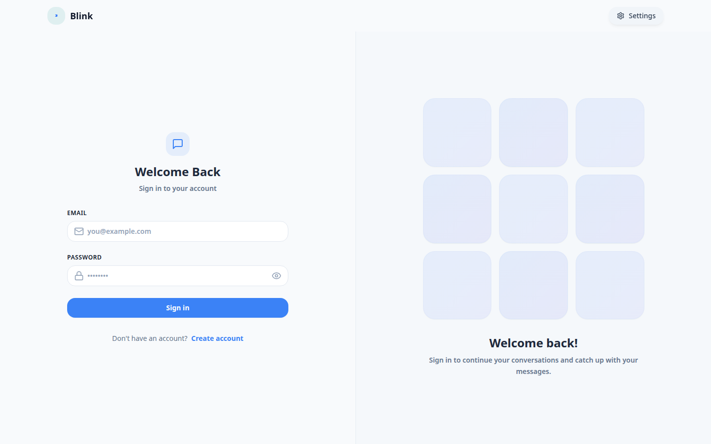
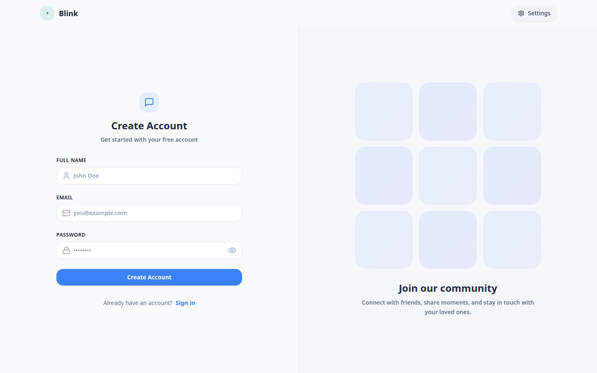
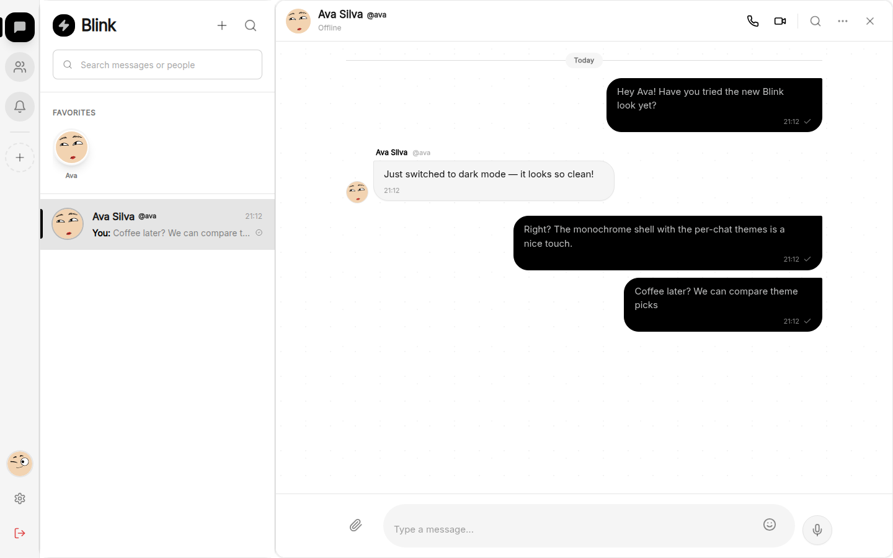
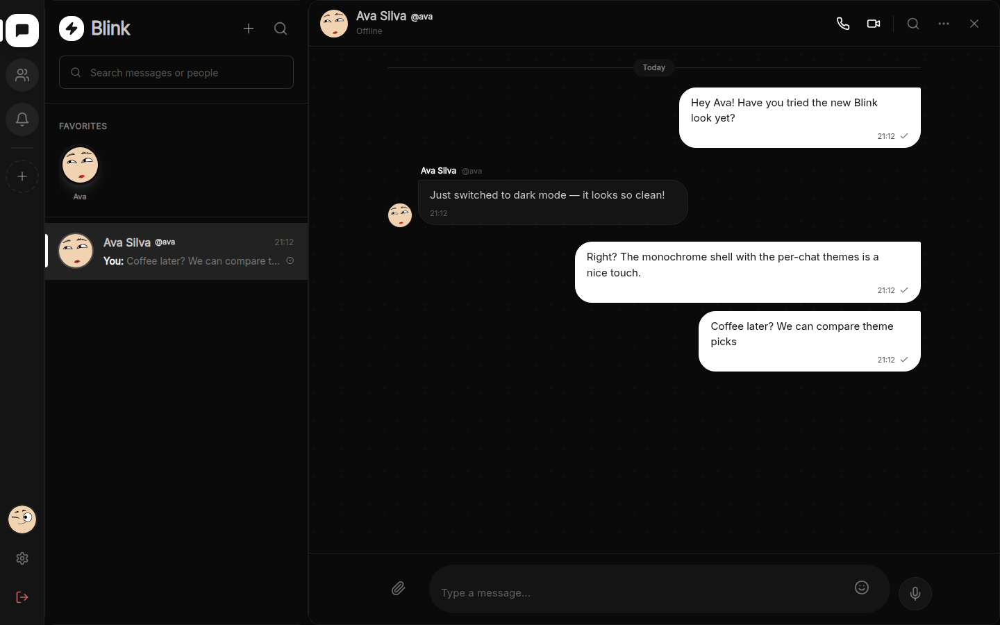
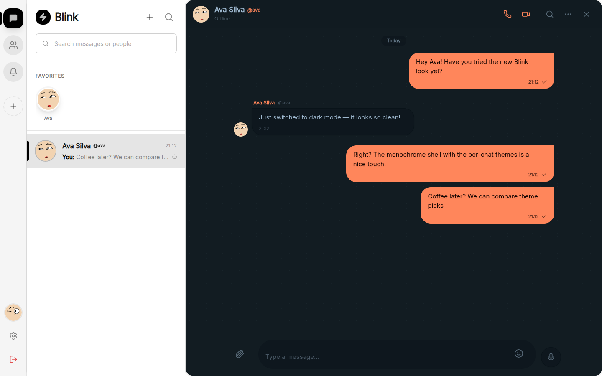
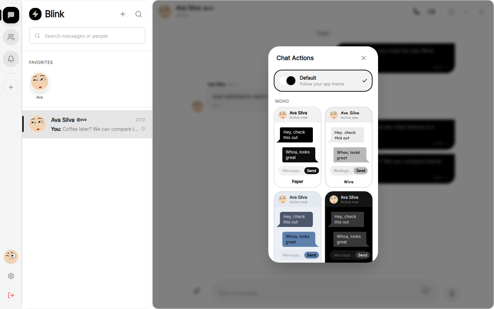

<p align="center">
  
</p>

<h1 align="center">Blink</h1>

<p align="center">
  <strong>Blink by IOP — a simple, powerful, and secure messenger for the web.</strong>
</p>

<p align="center">
  Blink uses your browser's data connection to communicate in real time.
  Send and receive high-fidelity messages, share media, react, reply, and stay connected
  in DMs, groups, and workspaces — free and instantaneous, anywhere in the world.
</p>

<p align="center">
  <a href="https://blink.koyeb.app"><strong>Try it live: blink.koyeb.app</strong></a>
</p>

<p align="center">
  <a href="https://github.com/pansiluchethiya/Blink/actions"></a>
  <a href="https://github.com/pansiluchethiya/Blink/blob/main/LICENSE"></a>
  
  
  
  
</p>

<p align="center">
  Also runs as a single monolith: one Docker image serves the API, Socket.io, and the built frontend.
</p>

---

## Screenshots

| Login | Sign up |
|-------|---------|
|  |  |

| Chat | Chat — dark |
|------|-------------|
|  |  |

| Themed chat | Theme picker |
|-------------|--------------|
|  |  |

> Screenshots are captured automatically with `docs/screenshots/capture.py` (Playwright). Re-run it after UI changes so the README stays fresh.

## Features

- **Real-time messaging** — Socket.io DMs with typing indicators, delivery + read receipts, online presence
- **Rich messages** — text + Markdown, code blocks, replies, threads, forwards, reactions, edit history, pin, delete
- **Disappearing content** — view-once media, expiring messages with automatic cleanup
- **Media & GIFs** — Cloudinary image/file uploads, Giphy GIF + sticker search
- **Friends & groups** — friend requests, blocking, groups, communities, workspaces with channels, polls, and resources
- **Organization** — chat folders, pinned / muted / archived / locked chats, message search, shared-media panel, export chat
- **Notifications** — in-app bell + Web Push (VAPID), per-chat preferences, mentions and replies
- **Personalization** — light / dark mode, custom theme builder, status messages, profiles, avatars
- **PWA** — installable, offline shell, service worker
- **Security by default** — JWT in httpOnly cookies, bcrypt password hashing, rate limiting, expiring sessions

## Stack

| Layer | Technology |
|-------|------------|
| Front-end | React 18, Vite 5, TailwindCSS 3 + daisyUI, TypeScript, Zustand, React Router, Socket.io-client |
| Back-end | Node.js 20, Express 4, Socket.io 4, TypeScript, Prisma 6 |
| Database | Postgres 18 (Koyeb, Singapore) via Prisma ORM |
| Auth | JWT (httpOnly cookie) + bcrypt |
| Media | Cloudinary |
| Push | Web Push (VAPID) + node-cron cleanup jobs |
| Deploy | Single Koyeb Eco service (Dockerfile, 512 MB) — backend serves `backend/public` |

## Getting started

Prerequisites: Node.js >= 20, a Postgres database (local or Koyeb).

```bash
# clone
git clone https://github.com/pansiluchethiya/Blink.git
cd Blink

# env
cp .env.example backend/.env
# edit backend/.env -> set DATABASE_URL, JWT_SECRET, Cloudinary keys

# backend (terminal 1)
cd backend && npm install
./node_modules/.bin/prisma migrate dev   # creates tables
npm run dev                                # http://localhost:5001

# frontend (terminal 2)
cd frontend && npm install && npm run dev  # http://localhost:5173
```

The frontend dev server proxies `/api` and `/socket.io` to `http://localhost:5001` (see `frontend/vite.config.ts`), so no CORS setup is needed locally.

Health check: `GET /api/health`.

## Production (Koyeb)

One Eco service builds the repo `Dockerfile`:

1. Frontend is built with Vite and copied into `backend/public`.
2. Backend runs `prisma migrate deploy` on boot, then starts Express + Socket.io.
3. Express serves `/api/*`, Socket.io on the same port, and the SPA fallback for everything else.

Required service env vars (Koyeb dashboard → Service → Environment):

| Var | Value |
|-----|-------|
| `DATABASE_URL` | Postgres connection string, `?sslmode=require` |
| `FRONTEND_URL` | Public app URL, e.g. `https://blink.koyeb.app` (used for CORS) |
| `JWT_SECRET` | Long random string (min 32 chars) |
| `CLOUDINARY_CLOUD_NAME` / `CLOUDINARY_API_KEY` / `CLOUDINARY_API_SECRET` | Media uploads |
| `HELP_CENTER_EMAIL` / `HELP_CENTER_PASSWORD` | Seeded support account |
| `VAPID_PUBLIC_KEY` / `VAPID_PRIVATE_KEY` / `VITE_VAPID_PUBLIC_KEY` | Web push (optional) |
| `VITE_GIPHY_KEY` | GIF + sticker search (optional, free at developers.giphy.com) |

## Project layout

```
frontend/                 # React SPA (Vite)
  src/
    pages/                # Login, SignUp, Home, Profile, Settings, Notes, Share, ...
    components/           # ChatContainer, MessageInput, Sidebar, Modals, ...
    store/                # Zustand stores (auth, chat, notifications, theme, errors)
backend/
  prisma/schema.prisma    # Users, Messages, Friendships, Groups, Workspaces, ...
  prisma/migrations/      # applied with `prisma migrate deploy` on boot
  src/
    controllers/          # auth, message, friendship, notification, workspace, ...
    routes/               # /api/auth, /api/messages, /api/friends, /api/workspaces, ...
    lib/prisma.ts         # Prisma singleton + _id response helpers
    lib/socket.ts         # Socket.io realtime layer
    middleware/           # JWT auth, error handler, logger
  public/                 # built frontend (Docker build only, gitignored)
Dockerfile                # single-image monolith build
docs/screenshots/         # README screenshots + capture.py
```

API compatibility note: responses keep the Mongo-style `_id` field (string UUIDs), so existing clients keep working.

## Contributing Bug Reports

We use GitHub for bug tracking. Please search the existing issues for your bug and create a new one if the issue is not yet tracked!

https://github.com/pansiluchethiya/Blink/issues

Include: what you did, what you expected, what happened, browser + console logs, and steps to reproduce.

## Contributing Code

New to the codebase? Pick a small issue to get familiar, then open a PR.

```bash
git checkout -b feat/my-change
# make your change, keep PRs focused
npm run lint --prefix frontend
git commit -m "feat: short description"
git push -u origin feat/my-change
```

For larger changes and feature ideas, please open an issue first for high-level discussion before implementation.

## Contributing Ideas

Have something you want to say about Blink or want to be part of the conversation? Open a [discussion or issue](https://github.com/pansiluchethiya/Blink/issues) — feature requests and UX feedback are welcome.

## Support

For troubleshooting and questions, please check:

- Live app: https://blink.koyeb.app
- Issues: https://github.com/pansiluchethiya/Blink/issues
- Env template: `.env.example` (all required keys documented there)

## Documentation

Looking for more docs?

- Local dev + deploy: this README (`Getting started`, `Production`)
- Data model: `backend/prisma/schema.prisma`
- Screenshots: `docs/screenshots/`
- Frontend tooling: Storybook (`frontend/README.md`), Cypress e2e, PWA manifest

# Legal things

## Cryptography Notice

This distribution includes cryptographic software (TLS via the hosting provider, bcrypt password hashing, JWT authentication). The country in which you currently reside may have restrictions on the import, possession, use, and/or re-export to another country, of encryption software. BEFORE using any encryption software, please check your country's laws, regulations and policies concerning the import, possession, or use, and re-export of encryption software, to see if this is permitted. See <http://www.wassenaar.org/> for more information.

## License

Copyright (C) Blink contributors. Licensed under the GNU GPL-3.0 — see [LICENSE](LICENSE).

Blink logo (`logo.png`) and screenshots in `docs/screenshots/` are part of this repository under the same license unless noted otherwise.
